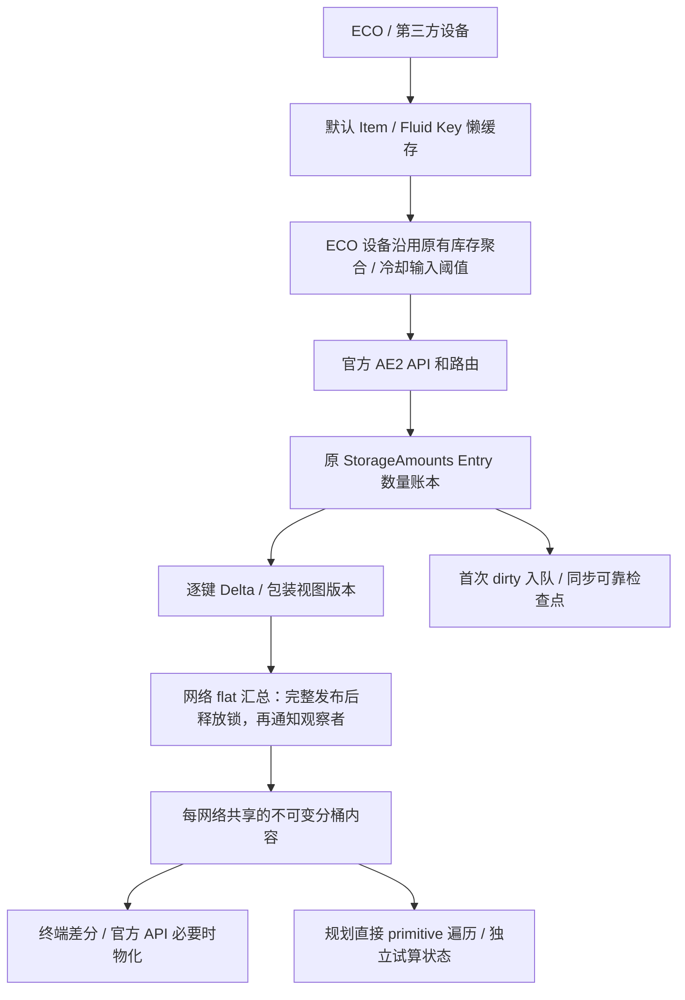

# ECO 1.20.1 第二阶段综合性能架构升级

日期：2026-11-09。目标实现：官方 AE2 15.4.11 / Minecraft 1.20.1 / Forge 47.4.28，Mod 版本仍为 20.5.6。

已在独立工作树实施并验证 P1～P5 的可采用部分，P6 完成保存分阶段测量和恢复回归，保留同步保存。数量账本、超 long 精度、迁移回执和持久化协议均保留。没有提交、推送或安装 JAR；真实游戏验收按本次约定排除。

500/20 离线完整工作负载中，普通盘终端捕获耗时 7,105.90 → 6,225.05 ns/轮（12.4% 下降），含 40 次 IO 的规划捕获 120,121.65 → 36,106.35 ns/轮（69.9% 下降）。这些是子系统结果，不能换算成游戏 TPS。

## 基线、资料与交付范围

- 普通主工程起点：`f2191704865b025aaf3ede6b1f344a01e7993802`，开始时干净。
- Performance 工作树起点：`9d170fba4f4d8a0b6c6eec992b8e04b70a994598`，包含 48 个未提交性能文件。实际文件先冻结，再移入新工作树；`ECOStorageInterfaceTransfer` 做三方合并，保留主工程已有 GTL 路径。
- 本轮工作树：`C:/Users/hnhjy/.codex/worktrees/eco-architecture-phase2/NeoECOAEExtension-1.20.1`，分支 `codex/eco-architecture-phase2`。
- **P0 性能基线已经包含上述 Performance 改动**，不是未优化的原始主工程。带 tag 流体短路属于继承内容；本轮没有重复应用，也没有把它说成已经进入原主工程。
- 报告名称中的 GTO 指技术参考；补丁目标是普通 ECO 1.20.1。未修改 GTO 工程、GTOCore 或官方 AE2 仓库源码。

完整读取的依据：

1. [ECO 三套存储实现横向比较](<C:/Users/hnhjy/Desktop/ECO存储横向比较-2026-11-09/报告.md>)
2. [中后期单库高频 IO 与查询](<C:/Users/hnhjy/Desktop/ECO存储横向比较-2026-11-09/中后期单库高频IO与查询.md>)
3. [GTO-vs-ECO-1.20.1-long-only-performance-audit](<C:/Users/hnhjy/Desktop/ECO存储横向比较-2026-11-09/GTO-vs-ECO-1.20.1-long-only-performance-audit.md>)
4. [Key 身份与 Map 实现研究 REPORT.md](<E:/Minecraft Project/ECO-KeyMap-Research-20261109/REPORT.md>)

参考更新记录见 [reference-update.json](<E:/Minecraft Project/ECO-Architecture-Phase2-20261109/reference-update.json>)：官方 AE2 固定 `forge/v15.4.11`；GTO Fork `da4d5634`；GTOCore-Main `5b92d4d3`。GTOLib 远端返回 Repository not found，使用已注明版本的本地 `b92e5311`，没有把它标成最新远端。

交付：[完整补丁（基于 f2191704）](<E:/Minecraft Project/ECO-Architecture-Phase2-20261109/delivery/ECO-phase2-full.patch>)、[仅本阶段增量（基于冻结 P0）](<E:/Minecraft Project/ECO-Architecture-Phase2-20261109/delivery/ECO-phase2-incremental-from-P0.patch>)、[JAR](<E:/Minecraft Project/ECO-Architecture-Phase2-20261109/delivery/neoecoae-20.5.6.jar>)、[审查压缩包](<E:/Minecraft Project/ECO-Architecture-Phase2-20261109/ECO-Phase2-Review.zip>)。应用其中适合目标基线的一份补丁，不能把两份叠加。SHA-256、正向应用后的逐文件比对、反向检查和原工作树核对见 [verification.json](<E:/Minecraft Project/ECO-Architecture-Phase2-20261109/delivery/verification.json>)。

## A. 架构变化

P0 的完整读取链：

```text
设备 → 官方/ECO Key 工厂 → 官方 AE2 路由 → ECO StorageAmounts Entry 账本
                                          ↓ 版本/已有 Delta
                         NetworkInventoryCache：逐挂载 flat 表 + 汇总表
                                          ↓
                         Terminal Cache：flat 表 + working KeyCounter
                                          ↓
                         分桶快照 → 官方迭代器物化 → 规划库存
                                          ↓
                         dirty 队列 → NBT/GZIP/force/校验/备份/原子替换
```

本轮后的链路：



未另建生产用全局 resolver、第二种数量账本或设备物品账本。终端删除了重复的 `working KeyCounter`；官方 StorageService 的公开计数器、网络逐挂载贡献和终端发布内容仍承担不同生命周期，不能把它们描述成全系统只有一张表。

## B. Key Factory

`DefaultKeyOwnerMixin` 给注册 Item/Fluid 增加一个懒 `KeyReuseSlot`，资源构造和注册时不创建 AEKey。首次官方工厂调用正常创建 Key，随后只在受控默认域复用；同一个槽位也供 `ECOKeyFactory` 使用，避免平行缓存。

- Item 在官方已完成 capability 序列化及规范化的三参数 `of` 边界拦截，只缓存 `tag == null && caps == null`。不调用私有构造器，不增加反射构造路径。
- Fluid 只缓存 null tag。带 tag 的流体沿用已存在的短路，不建立 FluidStack 后再检查；普通流体 canonicalize 也直接使用 Fluid。
- null NBT 与空 NBT 保持不同；不同 NBT、序列化 capability 不合并。外部等值不同引用 Key 仍通过内容相等命中账本。
- 初始化采用槽位同步，读取无需加锁；复用现有 epoch 和弱槽位登记。配置重载、关闭/清理时失效，过期发布受 epoch 检查约束。
- 新工厂/快照/包装 Mixin 只对已核对的官方 AE2 15.4.11 开启；其余版本保留现有公开 API 回退。默认显示 ItemStack 仍按官方方式懒初始化，避免工厂回调重入。

默认 Key 工厂对照（500/20，按一次工厂调用归一化，三 JVM 中位数）：

| 路径 | 前 ns/次 | 后 ns/次 | 前 B/次 | 后 B/次 |
| --- | --- | --- | --- | --- |
| factory-item | 21.00 | 6.82 | 80.00 | 0.00 |
| factory-item-stack | 23.70 | 13.80 | 80.00 | 0.00 |
| factory-fluid-default | 9.84 | 5.35 | 56.00 | 0.00 |
| factory-tagged-fluid-repeat | 183.59 | 216.15 | 416.00 | 416.00 |
| factory-tagged-fluid-churn | 196.36 | 188.82 | 416.00 | 416.00 |

这些工厂收益不能直接当作完整存储吞吐增幅。工厂加真实普通盘的 40 次 IO/轮对照是 3,991.65 → 3,952.88 ns/轮，分配 3,200 → 0 B/轮；耗时差很小。

带 tag 弱值缓存只保留测试原型：重复命中约 145 ns/次，普通工厂约 216 ns/次；高周转约 444 ns/次，普通工厂约 189 ns/次，且分配更多。因此未部署全局弱值规范化，也不引入每次额外 resolver。带 tag 工厂的同路径对照存在回退，表中照实保留。

内部引用比较只用于已拥有的槽位、最近键快路径和存储句柄身份；所有资源表保留内容相等语义。没有让官方 AE2 或第三方设备依赖引用唯一性。

## C. Primitive 数据布局

保留 `Object2ObjectOpenHashMap<AEKey, Entry>` 和 Entry 内 primitive long。超 long 数量、Entry 变化链及保存格式不变。P0 与最终版 `StorageAmounts.class` 字节核对：**一致**；`ECOStorageCell.class`：**一致**，详情见 [字节核对](<E:/Minecraft Project/ECO-Architecture-Phase2-20261109/comparisons/unchanged-ledger-bytecode.json>)。

生产读侧继续采用现有 FastUtil `Object2LongOpenHashMap`，没有为一个 FlatKeyCounter 名称增加包装或长期镜像。`StorageCounterLayouts` 只在测试侧实现并核对官方 KeyCounter、现有 flat 表和开放寻址 Entry[]，包含扩容、删除、碰撞、等值键、独立复制及溢出边界；不会进入 Mod JAR。

500 项布局测量（三进程中位数）：

| 布局 | 遍历 ns | 遍历 B | 独立复制 ns | 独立复制 B |
| --- | --- | --- | --- | --- |
| native | 20,298.00 | 36,096.00 | 77,288.67 | 292,528.00 |
| eco-flat | 1,242.33 | 0.00 | 954.33 | 12,928.00 |
| entry-array | 704.00 | 0.00 | 3,297.33 | 16,216.00 |

Entry[] 遍历有收益，但独立复制不如现有 flat 表，完整 IO 又没有新的优势证据，故不替换。

终端继续使用 32 个不可变桶，修正分桶与桶内 FastUtil 复用低位 hash 的碰撞问题：高 5 位选桶，桶内使用低位。稀疏更新只复制受影响桶，密集批次重建；桶内 long 数组独立复制，不共享可变 Entry。旧发布内容不会被后续写入改变。需要原生迭代、模糊查询或可变视图时才物化完整 KeyCounter，连续完整读取时按已有策略转为原生发布。多读者共享发布内容及有界变化历史。

P5 删除终端额外 grouped working 表，精确数量覆盖直接读取已有 flat 表；规划使用 `visitVisibleAmounts`，避免为了遍历而物化原生分组索引。这里减少了常驻表示，但每轮分配并非全部下降，详见 G。

## D. 设备 IO

输出沿用 ECO 宿主已经拥有并保存的盘/无限域作为聚合位置，只缓存候选 Key。默认仍为每 tick 处理，最多 5 个 Key；可配置 1～20 tick 周期及提前发送阈值，默认阈值为 64 原始单位（物品个数或流体 mB）。资源一直保留在权威库存中，不需要新增延迟保存的物品缓冲。

配置位于现有 storage 配置组：`outputTransferIntervalTicks=1`、`outputFlushThreshold=64`、`smartCoolingRefillThresholdPercent=75`。100% 冷却阈值可恢复原来的按周期补满策略。

网络不可用、目标不接受或无能量时保留源库存；源/目标句柄变化、重连、reset、时钟倒退重置调度。过滤规则每次实际操作前复核。等待周期时保留队列位置，防止轮转相位饿死；高周转删除候选有界。缓冲容量沿用宿主容量，额外内存只是候选集合，没有新的无上限物品副本。无限域仍保留原本超 long 的存储能力。

修复取空后补回相同数量、汇总 Delta 为零时漏掉候选的问题。成功发送后保留候选直到下一次列表确认空；输入/输出两方向均有回归。

保留目标二次 SIMULATE、实际 MODULATE 返回量、剩余量退回和官方能量计费；新增提取前能量预检，避免静态无电时先从只读来源扣货。**没有宣称同频下把两次目标 SIMULATE 合并成一次**。重入保护防止回调替换正在使用的转移队列。MEStorage 仍不提供跨第三方库存的原子事务；若一次转移中接收方和退回方同时拒收，原有退回路径无法提供通用事务保证，本次未引入持久化 escrow。

真实设备方法 + 官方网络路由的离线 2,000 tick 轨迹，500 种资源、20 个键各生产 1 单位/tick，总生产 40,000，阈值 64：

| 周期 tick | MOD/tick | SIM/tick | 最长已交付等待 tick | 平均等待 tick | 源内最大待发送单位 | 结束仍在源内 |
| --- | --- | --- | --- | --- | --- | --- |
| 1 | 5.00 | 10.00 | 3 | 1.50 | 50 | 30 |
| 5 | 1.00 | 2.00 | 19 | 9.48 | 250 | 230 |
| 10 | 0.50 | 1.00 | 39 | 19.43 | 500 | 480 |
| 20 | 0.31 | 0.62 | 63 | 31.37 | 920 | 660 |

这是刷新时效取舍，不是相同延迟下的算法加速。队列预算与阈值共同决定等待，周期 20 不等于所有键最多等 20 tick。500/500、1000/1000 密集生产时 5 键预算成为瓶颈，增加周期只小幅减少请求，且会增加初期等待。完整六组矩阵见 [设备轨迹 CSV](<E:/Minecraft Project/ECO-Architecture-Phase2-20261109/comparisons/device-traces.csv>)；三次 JVM 的数量、请求与延迟轨迹完全一致。

同频设备 API 对照：

| 工作负载 (n/k) | 前 ns/轮 | 后 ns/轮 | 耗时变化 | 前 B/轮 | 后 B/轮 |
| --- | --- | --- | --- | --- | --- |
| interface-output (500/20) | 4,391.85 | 3,464.15 | -21.1% | 536.00 | 536.00 |
| interface-input (500/20) | 3,351.40 | 2,621.00 | -21.8% | 120.00 | 112.00 |
| interface-multi-output (500/20) | 3,345.45 | 2,593.45 | -22.5% | 120.00 | 112.00 |

智能冷却输入先看实际本地罐体，满足阈值直接跳过网络；不足时按原 200 tick 轮询补到容量，按实际提取量入罐。断线、资源不足、换液退回失败保留原库存和后续需求。离线轨迹使用生产容量 16,384,000 mB，消耗 100 mB/tick，82,000 tick 两边都消耗 8,200,000 mB、结束罐内相同、付出 65,600 AE：

| 阈值 | 实际提取次数 | 模拟次数 | 最低本地库存 mB | 结束库存 mB |
| --- | --- | --- | --- | --- |
| 100 | 410 | 410 | 16364000 | 16384000 |
| 75 | 2 | 2 | 12284000 | 16384000 |

410 → 2 次的收益取决于这个大容量缓冲与持续低速消耗条件，不推广为所有输入设备的固定倍数。

## E. 网络 Delta 与终端

| 层 | 增量能力 | 失效与回退 |
| --- | --- | --- |
| 普通 ECO 盘 | 复用 Entry 变化链，合并同键最新值，多读者独立版本 | 删除/重新加入、日志过期、封存或所有权变化回退全量 |
| ECO 无限域 | 数量 Delta，稀疏超 long/无限来源侧通道 | 权限、域状态、迁移/结构变化重新建立基线 |
| DelegatingMEInventory | 只转发已核对的透明视图 | 未知子类不假设透明 |
| DriveWatcher / MEInventoryHandler | 公开已知视图的 content revision 与独立视图身份 | 配置 setter、底层句柄/身份改变形成 barrier |
| 精确过滤包装 | 最多 64 项原生 PrecisePriorityList，按真实成员过滤逐键变化 | 原地改规则也失效；大表、模糊、自定义、嵌套未知来源全量 |
| StorageBus / 第三方包装 | 保留过滤/作用域及原生路径 | 没有可靠版本时每次重新列表，不以底层未变证明过滤视图未变 |
| 终端 | 每网络共享不可变内容，最多 32 帧/65,536 变化键历史 | 读者落后、结构/epoch/时钟变化回退；没有变化不重建发布 |

过滤分支还核对了官方无参和带参数列表的差异：原生 `DelegatingMEInventory` 无参重载可能绕过包装过滤。过滤 Delta 只对直接 ECOStorageCell/ECOInfiniteStorage 的已核对等价重载开放，其他来源保守回退，不能绕过滤器。

网络批次使用 primitive API 与 epoch 去重，一次收集同键净变化，先更新所有公开数量，再释放挂载锁并统一通知 watcher。回调重入可以读取完成的批次、重新列表和改变挂载；回调失败会使缓存失效并在下次重建。新回归覆盖通知中的重读、挂载与移除。

包装对照（固定同一刷新频率；precise 场景为 5 项精确过滤规则）：

| 工作负载 (n/k) | 前 ns/轮 | 后 ns/轮 | 耗时变化 | 前 B/轮 | 后 B/轮 |
| --- | --- | --- | --- | --- | --- |
| wrapper-delegate (500/20) | 4,710.07 | 4,389.33 | -6.8% | 24.00 | 24.00 |
| wrapper-drive (500/20) | 4,585.43 | 4,390.97 | -4.2% | 24.00 | 24.00 |
| wrapper-precise (300/5) | 43,847.18 | 1,501.78 | -96.6% | 194,272.00 | 1,296.00 |
| wrapper-precise (500/20) | 85,652.03 | 4,057.10 | -95.3% | 325,712.00 | 1,296.00 |

诊断运行另保存在 `p2-wrapper-diagnostics-verified` / `p5-wrapper-diagnostics`，包含 full/delta/listed/changed 计数。普通终端在同 tick 共享同一发布；强实时规划捕获显式刷新普通和精确数量，不用先前同 tick 的陈旧规划库存。未改变原终端同步协议、默认刷新间隔或另建名称/排序完整镜像。

## F. 查询复用和规划

精确查询优先使用已有内容相等表、最近键快捷路径与不可变快照精确 `get`；没有建立全局永久的“没有资源/不能提取”缓存。对同网络同次发布复用查询结果，未知版本重新列表。

`CombinedStorage` 的候选集合归宿主所有，随挂载句柄身份重建。只为**插入**排除原生普通 ECO 盘明确不支持的物品/流体类型；自定义 AEKeyType、ECOStorageCell 子类、无限域与未知存储都保留。动态过滤、容量、访问权限每次由真实存储判断，不做永久负缓存。提取不按插入类型筛掉旧存档/迁移内容。

500/20 完整插入/提取批次，目标物品盘前置 0/15/63 个流体盘：

| 工作负载 (n/k) | 前 ns/轮 | 后 ns/轮 | 耗时变化 | 前 B/轮 | 后 B/轮 |
| --- | --- | --- | --- | --- | --- |
| candidate-insert-1-mounts (500/20) | 8,973.00 | 9,119.55 | +1.6% | 2,158.66 | 2,157.89 |
| candidate-insert-16-mounts (500/20) | 29,479.20 | 17,554.70 | -40.5% | 2,560.00 | 960.00 |
| candidate-insert-64-mounts (500/20) | 137,389.65 | 79,747.25 | -42.0% | 2,560.00 | 960.00 |

单盘无收益；混合盘减少不支持类型的插入调用。没有修改官方 NetworkStorage 的全局候选路由。

规划直接遍历 primitive 快照；仅异常大数/无限资源参与精确覆盖，普通盘不重新构建完整精确侧表。不可变 `PlannerInventorySnapshot` 供同轮多个试算复用，试算消耗、预留量各自隔离；保留 PlannerAmount 精度。原生模糊视图按需物化，没有为了精确查询先建立模糊索引，也没有按每次尝试重新遍历网络。

| 工作负载 (n/k) | 前 ns/轮 | 后 ns/轮 | 耗时变化 | 前 B/轮 | 后 B/轮 |
| --- | --- | --- | --- | --- | --- |
| planner-capture (300/300) | 24,648.00 | 25,105.00 | +1.9% | 59,048.00 | 37,384.00 |
| planner-capture (500/500) | 42,986.50 | 25,753.50 | -40.1% | 98,960.00 | 62,928.00 |
| planner-update-capture (500/20) | 120,121.65 | 36,106.35 | -69.9% | 389,561.86 | 72,816.43 |
| planner-capture (1000/1000) | 104,542.50 | 53,523.00 | -48.8% | 195,184.00 | 125,136.00 |

其中 planner-capture 是不变库存的完整捕获；planner-update-capture 包含 20 键的 40 次 IO 后再捕获，不是一次 Map.get。隔离 P5 的专门对照还在 `p4-planner / p5-planner`，结论方向一致。

| 工作负载 (n/k) | 前 ns/轮 | 后 ns/轮 | 耗时变化 | 前 B/轮 | 后 B/轮 |
| --- | --- | --- | --- | --- | --- |
| two-domains (500/20) | 4,653.62 | 4,401.32 | -5.4% | 139.93 | 128.91 |
| fuzzy-two-domains (500/20) | 9,891.88 | 7,265.30 | -26.6% | 216.00 | 192.00 |
| four-viewers-two-domains (500/20) | 8,434.38 | 7,180.07 | -14.9% | 10,137.30 | 9,012.93 |
| unknown-wrapper-two-domains (500/20) | 220,237.58 | 215,727.58 | -2.0% | 208,512.00 | 208,568.00 |
| four-viewers-fuzzy-two-domains (500/20) | 67,839.30 | 44,488.15 | -34.4% | 22,952.88 | 22,906.57 |

两域测试是两个不同物理库存的同 Key 汇总，不能当作共享物理 DAG 去重成功。复杂共享子网缺少已确认的高频实际负载及稳定物理身份/过滤视图契约，本轮不猜测 physical token、不复制 Fork NetworkStorage。重复挂载、递归/作用域和未知来源继续按既有 AE2 语义回退。

缓存所有权和读取契约：

| 缓存 | 拥有者 / 修改者 | 读取者 | 失效与保守路径 |
| --- | --- | --- | --- |
| 默认 Key 槽 | 注册 Item/Fluid；官方/ECO 工厂初始化 | 工厂调用者，按 epoch 读 | 重载/停用清槽；无法命中时使用官方创建 |
| 网络 flat 贡献与汇总 | StorageService 或私有 IO 缓存；服务器线程刷新 | 该拥有者的批次发布/观察者 | 挂载、视图身份、内容版本；未知即全量，后台读取走 AE2 回退 |
| 终端分桶内容 | 每网络 Source.Cache；服务器线程生成新发布 | 多个终端只读共享，历史游标各自消费 | 新 tick/强捕获检测变化；过期、scope、结构改变回退 |
| 规划基础库存 | 一次捕获创建，之后不可变 | 该轮规划/试算；消耗写入各自 PlannerCounter | 下一次强捕获重新检查普通及精确库存 |
| 类型候选 | 每宿主 CombinedStorage；随句柄列表重建 | 实际插入调用 | 只排除已知不支持类型；容量/过滤/权限仍实时调用 |
| IO 候选队列 | 宿主 IO transfer；仅服务器线程 | 当前转移过程 | 网络、源、过滤、reset 失效；队列不拥有物品 |

## G. 性能对比与测量边界

环境：Windows 11，AMD Ryzen 9 7845HX（12 核/24 线程）；Java 17 编译/回归，Zulu Java 21.0.1 执行对照基准，固定 512 MiB、G1、JFR，所有 Gradle 与性能 JVM 串行。

每组通常为 3 个独立 JVM，单 JVM 7 个测量批次；主要最终链路 6 轮预热、2 倍迭代，包装 8/3，工厂 12/4，孤立数量表 12/6；精确参数在各组 `java.args`。表取 JVM 中位数的中位数，进程范围、ns/op、B/op、ops/s、原始批次数组及 GC 记录见 [完整 234 组配对数据](<E:/Minecraft Project/ECO-Architecture-Phase2-20261109/comparisons/comparison.json>) 和 [可读完整表](<E:/Minecraft Project/ECO-Architecture-Phase2-20261109/comparisons/comparison-all.md>)。

同组前后使用相同资源集合构造、批次、刷新频率、JVM 参数和正确性断言。最终主链/查询/包装复用冻结 `p5-harness.jar`；流体补充矩阵使用 `final-harness.jar`，文件与哈希另存。P0/main/阶段 JAR、织入目标 manifest 和原始 JFR 全部保留。

普通盘 API 测试使用真实 ECOStorageCell、仓库及官方路由，服务发现边界由测试环境提供。为满足 500/1000 单库场景，仅在测试盘提升类型上限至 10,000；真实 L9 字节/每类型开销保持，初始物品占用约 85%。它不是原版 315 类型物品盘的游戏配置。流体补充使用水/岩浆的 NBT 变体，涵盖少 primaryKey、多 variant 的另一种布局。

六组主矩阵：

| 工作负载 (n/k) | 前 ns/轮 | 后 ns/轮 | 耗时变化 | 前 B/轮 | 后 B/轮 |
| --- | --- | --- | --- | --- | --- |
| cell-direct (100/1) | 382.36 | 284.32 | -25.6% | 0.00 | 0.00 |
| cell-direct (300/5) | 728.31 | 735.29 | +1.0% | 0.00 | 0.00 |
| cell-direct (500/20) | 2,887.65 | 2,801.40 | -3.0% | 0.00 | 0.00 |
| cell-direct (500/500) | 75,634.50 | 74,484.00 | -1.5% | 0.00 | 0.00 |
| cell-direct (1000/20) | 3,486.15 | 2,916.55 | -16.3% | 0.00 | 0.00 |
| cell-direct (1000/1000) | 158,538.50 | 184,452.50 | +16.3% | 0.00 | 0.00 |

六组终端矩阵：

| 工作负载 (n/k) | 前 ns/轮 | 后 ns/轮 | 耗时变化 | 前 B/轮 | 后 B/轮 |
| --- | --- | --- | --- | --- | --- |
| cell-terminal-one (100/1) | 940.25 | 622.93 | -33.7% | 1,264.38 | 1,241.15 |
| cell-terminal-one (300/5) | 2,271.47 | 1,999.99 | -12.0% | 2,824.00 | 3,217.40 |
| cell-terminal-one (500/20) | 7,105.90 | 6,225.05 | -12.4% | 8,552.00 | 9,936.00 |
| cell-terminal-one (500/500) | 176,993.00 | 135,006.00 | -23.7% | 43,232.00 | 44,040.00 |
| cell-terminal-one (1000/20) | 7,951.70 | 6,609.55 | -16.9% | 13,546.38 | 15,313.60 |
| cell-terminal-one (1000/1000) | 391,375.99 | 296,604.00 | -24.2% | 81,616.00 | 81,608.00 |

六组带 NBT 流体矩阵：

| 工作负载 (n/k) | 前 ns/轮 | 后 ns/轮 | 耗时变化 | 前 B/轮 | 后 B/轮 |
| --- | --- | --- | --- | --- | --- |
| fluid-cell-direct (100/1) | 321.87 | 236.37 | -26.6% | 0.00 | 0.00 |
| fluid-cell-direct (300/5) | 721.49 | 788.73 | +9.3% | 0.00 | 0.00 |
| fluid-cell-direct (500/20) | 2,601.75 | 2,828.20 | +8.7% | 0.00 | 0.00 |
| fluid-cell-direct (500/500) | 67,592.00 | 71,374.50 | +5.6% | 0.00 | 0.00 |
| fluid-cell-direct (1000/20) | 2,580.80 | 2,591.45 | +0.4% | 0.00 | 0.00 |
| fluid-cell-direct (1000/1000) | 135,056.00 | 145,477.50 | +7.7% | 0.00 | 0.00 |

直接普通盘、官方网络路由不是主要获益点。500/20 物品盘直接 IO 约 -3.0%，官方网络普通盘约 -1.0%；带 NBT 流体直接 IO 2,601.75 → 2,828.20 ns/轮（+8.7%），没有改善，不能隐去这个回退。

分配也不是全线下降：500/20 普通盘终端 8,552.00 → 9,936.00 B/轮；最终主链私有缓存部分场景 24 → 56 B/轮。规划更新捕获则 389,561.86 → 72,816.43 B/轮，默认 Key 工厂降至 0 B/次。保留了消除分桶碰撞、重复物化和锁内回调的改动，同时公开这些代价；没有把所有内存都声称减少。

混合基准中未修改的 raw-long 500/20 也出现 +46.4% 波动；追加孤立重复测量为 377.60 → 412.30 ns/轮（+9.2%）。这不足以支持“数量表算法已加速”，也不能以此未经完整调用链证据替换数量表。原始结果与额外对照都保留。

GC 为各 JVM 的整个测量窗口，不是单次操作暂停：

| 500 项负载 | 前 GC 次数（3 JVM） | 后 GC 次数 | 前累计 GC ms | 后累计 GC ms |
| --- | --- | --- | --- | --- |
| cell-terminal-one | [0, 1, 0] | [1, 1, 0] | [0, 3, 0] | [4, 4, 0] |
| domain-terminal-one | [1, 0, 1] | [1, 1, 1] | [4, 0, 4] | [4, 5, 3] |
| planner-capture | [1, 0, 0] | [0, 0, 0] | [1, 0, 0] | [0, 0, 0] |
| planner-update-capture | [17, 17, 17] | [3, 3, 3] | [25, 25, 24] | [8, 9, 8] |

没有统计存活堆的统一下降比例。实际服务器 tick p50/p95/p99、游戏 TPS、真实整包 CPU/GC 均未测量；`StoragePerformance.Phase.TICK` 在这些离线测量中没有样本。Windows ThreadMXBean 的 CPU 时间分辨率也不能替代墙钟批次或真实服务器分析。

## H. 正确性、构建和保存

所有阶段均完成编译及相应回归，失败的测试编写/基准入口尝试保留日志，修正后才采用数据：

| 阶段 | 项数 | 通过 | 跳过 | 失败/错误 |
| --- | --- | --- | --- | --- |
| p0 | 341 | 338 | 3 | 0 |
| p1 | 342 | 339 | 3 | 0 |
| p2 | 343 | 340 | 3 | 0 |
| p3 | 345 | 342 | 3 | 0 |
| p4 | 352 | 349 | 3 | 0 |
| p5 | 355 | 352 | 3 | 0 |
| final-fixture-verified | 356 | 353 | 3 | 0 |

最终没有织入的回退环境：356 项，349 通过、7 跳过、0 失败。开启诊断开关另跑 `StoragePerformanceTest`：2 项通过，验证线程隔离与真实 Entry/tombstone 计数。常规的 3 项跳过是旧可选性能入口和这 2 项诊断测试；回退环境另外跳过 4 项确实要求织入的测试。

新增或扩展的回归集中于明确风险，覆盖：

- 默认键同引用、等值不同引用、epoch/关闭后重新创建、空/非空 NBT、不同序列化 capability、并发创建和失效。
- 哈希冲突/扩容/删除、超 long 边界、资源删除再插入、多读者游标、日志过期和封存 barrier。
- 同键多盘饱和及精确总量、未知/嵌套/大过滤包装、原地改规则、权限开关、scope 隔离、回调失败及重入挂载/查询。
- 旧快照独立、多读者并发物化、同 tick 多键变化后的强规划捕获、预留与试算隔离。
- SIMULATE 不扣货、实际部分 MODULATE、能量不足、源/目标/过滤变化、重连、同量补货候选、reset/卸载时资源仍归原库存。
- dirty 时再次修改、首次入队期限、显式 flush 后继续修改、保存失败无新修改重试、关闭失败后重试、迁移回执/预算及旧格式/未知条目恢复。

最终离线实际织入核对 8 个目标：Item、Fluid、AEItemKey、AEFluidKey、KeyCounter、DelegatingMEInventory、MEInventoryHandler、PrecisePriorityList；随后使用最终 fixture 重新完成 356 项回归。完整 Forge 启动、整包 Mixin 并存及游戏功能交互没有执行，不能由这些测试替代。

最后一次联网 Gradle 依赖检查遇到 Forge Maven TLS 握手失败，随后使用已校验且此前已成功构建的缓存依赖 `--offline` 完成最终构建、织入/回退及诊断回归，没有改依赖版本或弱化检查。

### 保存与 P6

沿用首次 dirty 入队、每次有效修改推进 contentRevision、同步检查点、失败保留 dirty、写入成功后推进 durableRevision、迁移回执、flushThrough、卸载/关服刷新。没有删除备份、读回或原子替换，没有新增异步保存线程。

每个检查点修改所有 n 个数量，写出后校验重新加载数量和 durableRevision。每大小 3 JVM × 24 次正式检查点，另有预热，以下为**离线文件检查点**分位数：

| 资源数 | 样本数 | p50 ms | p95 ms | p99 ms | 平均分配中位数 B | 压缩文件 B |
| --- | --- | --- | --- | --- | --- | --- |
| 100 | 72 | 10.06 | 12.33 | 12.59 | 284,048.33 | 963 |
| 300 | 72 | 11.62 | 12.59 | 12.74 | 649,886.00 | 2371 |
| 500 | 72 | 10.34 | 12.61 | 13.85 | 1,021,743.33 | 3797 |
| 1000 | 72 | 11.98 | 14.00 | 15.53 | 1,952,865.33 | 7467 |

500 项的诊断阶段均值（三 JVM 的每检查点均值再取中位数）：

| 阶段 | ms/检查点 |
| --- | --- |
| SNAPSHOT | 0.2994 |
| KEY_ENCODING | 0.1292 |
| NBT_GZIP_WRITE | 1.0010 |
| FILE_FORCE | 1.8131 |
| READBACK | 0.8887 |
| BACKUP | 5.2076 |
| ATOMIC_MOVE | 0.7441 |
| DIRECTORY_FORCE | 0.0925 |
| DURABLE_CONFIRM | 0.0010 |

KEY_ENCODING 包含在 SNAPSHOT 中，不能重复相加。NBT 序列化、GZIP 和流式写出按真实代码合并计时，没有为了拆开压缩统计而添加完整中间缓冲。备份阶段包含文件复制、备份 force 和替换；DIRECTORY_FORCE 是平台支持时的尝试，并不额外宣称 Windows 目录强制落盘成功。

备份/force 是当前离线检查点的大头。队列的 2 ms 调度预算只能约束开始下一个检查点，不能中断正在写的文件。本次没有真实服务器 tick 长尾证据，因此保留同步可靠性协议；这些数据是以后决定是否引入异步 IO 的依据。

## I. 剩余瓶颈与未采用项

1. 直接存储 API 已较轻，默认 Key 缓存明显减少创建，但不能推导整个服务器显著加速。带 NBT 流体直接 IO 和部分分配指标没有改善。
2. 官方 KeyCounter 仍是分组结构；完整遍历、模糊/可变视图边界仍需物化。没有替换全局 final KeyCounter，也未重写客户端排序或同步协议。
3. 大型/自定义/模糊/未知过滤包装与 StorageBus 仍可能全量列表；本次不以绕过过滤实现增量。
4. 官方 NetworkStorage 全局按类型路由、通用 physical token/shared DAG 去重与跨存储原子事务尚未移植。复杂图需要独立契约与负载证据，不能复制 Fork 或猜测视图等价性。
5. 设备一次最多 5 键；高键数密集生产的可见延迟仍由这个预算限制。较长周期只是一种明确可配置的请求/延迟取舍。
6. 检查点备份与 force 仍有毫秒级同步成本；未以削弱保存保障换取数字，也未在没有 tick 证据时增加异步状态。
7. tag 弱值规范化、Entry[] 生产替换未达到本阶段采用条件。没有遗留一个未启用的生产 resolver 或第二张数量表。

真实游戏验收和 GTL 合并不列入本轮待办。

## J. 最终判断

1. **是否保留优秀数量账本？** 是，Entry + primitive long 及超 long 精度、变化链、持久化格式全部保留。
2. **Key Factory 是否接近 GTO？** 默认注册资源实现同类懒缓存/稳定复用机制，工厂 0 B/次；没有新的同环境 GTO 工厂对测，不能宣称等速。tag 域仍保留内容语义与正常创建。
3. **是否减少设备网络请求？** 对实际 ECO 方法的离线轨迹是：500/20 的 5 tick 策略 MOD 5 → 1 次/tick，冷却示例 410 → 2 次；默认 1 tick 不强加延迟。
4. **是否减少全量库存刷新？** 是，普通盘/域已有 Delta 得以在受控包装和小精确过滤器中继续传播；未知视图全量回退。
5. **是否减少终端和规划重复构建？** 是，去掉终端 grouped working 镜像，规划直接读 primitive 快照，复用不可变基础库存与终端变化集合。
6. **是否实现安全查询复用？** 在每网络发布、版本化挂载及受控候选域内实现；内容相等与强规划刷新保留。复杂共享物理 DAG 不作成功声明。
7. **是否减少 CPU、分配和 GC？** 默认工厂、受控过滤、规划和部分终端路径有实测收益；不是所有路径，部分 B/轮与带 NBT 直接 IO 回退已公开。无整体服务器比例结论。
8. **300～500 高频 IO 改善多少？** 普通盘终端捕获约 12%，500/20 无限域终端约 30%，含 IO 的规划捕获约 70%，5 项精确过滤包装约 95%；直接普通盘/官方路由变化小。不能合成一个 TPS 提升值。
9. **吸收了哪些 GTO 优势？** 默认 Key 工厂复用、primitive 读侧、设备库存内聚合和输入阈值、包装 Delta、完整发布后通知、共享快照与受控类型候选、低开销 dirty 队列。
10. **哪些仍受官方 AE2 限制？** 全局路由/分组 KeyCounter、未知包装版本、共享物理子网去重、跨库存原子事务，以及原有客户端同步/排序边界。

## 复现与审查入口

- [阶段工作记录](<E:/Minecraft Project/ECO-Architecture-Phase2-20261109/WORK_LOG.md>)；[开始时工作树与文件哈希](<E:/Minecraft Project/ECO-Architecture-Phase2-20261109/start-state.json>)。
- [完整对照 JSON](<E:/Minecraft Project/ECO-Architecture-Phase2-20261109/comparisons/comparison.json>) / [完整 Markdown 表](<E:/Minecraft Project/ECO-Architecture-Phase2-20261109/comparisons/comparison-all.md>)，含所有配对结果，不只列收益场景。
- `tools/storage-performance/run.py` 支持冻结 main JAR、test/harness JAR 和织入 fixture；每个运行的 `.args`、结果 JSON、日志及 JFR 位于输出目录 `benchmarks/`。
- `tools/storage-performance/weave.py` 重现对锁定依赖字节码的有限 Mixin 验证；`summarize.py` 只读取标签后为数字的 JVM 目录，避免把相近标签的实验混在一起。
- [最终验证脚本](<E:/Minecraft Project/ECO-Architecture-Phase2-20261109/final_verification.py>)；[最终织入检查](<E:/Minecraft Project/ECO-Architecture-Phase2-20261109/final-fixture-check.json>)；[最终回归](<E:/Minecraft Project/ECO-Architecture-Phase2-20261109/final-fixture-verified-validation.json>)；[未织入回退](<E:/Minecraft Project/ECO-Architecture-Phase2-20261109/final-fallback-validation.json>)；[诊断回归](<E:/Minecraft Project/ECO-Architecture-Phase2-20261109/final-diagnostics-validation.json>)。
- 早期 `p2-wrappers` / `p2-wrapper-diagnostic` 用错无参列表 oracle，已作废；正式包装对照使用 `p2-wrappers-verified`。编译时一次测试调用 protected 方法的错误已修正，不属于最终代码失败。
- 补丁在文件副本中正向检查并应用后逐文件核对，且在当前工作树反向检查；导出使用临时 index，真实 index 与 HEAD 保持原样。检查结果及 JAR 内无 benchmark/AE2 目标类的核对见交付 `verification.json`。
