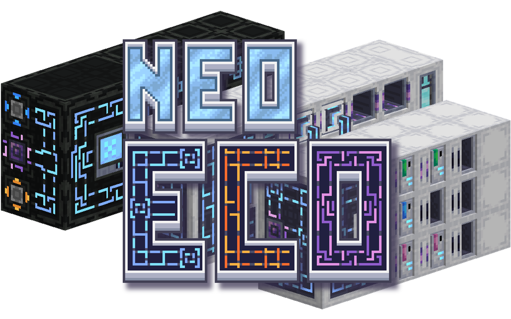

<h1 align="center">Neo ECO AE Extension</h1>

Expandable crafting, storage and computation for Applied Energistics 2.

  
  
  

<h1 align="center">

English | [简体中文](/README_ZH_CN.md) | [繁體中文](/README_ZH_HK.md) | [文言文](/README_LZH.md)

</h1>

<h2 align="center" id="supported-versions">Supported Versions</h2>

<table align="center">
  <thead>
    <tr><th align="center">Minecraft</th><th align="center">Loader</th><th align="center">Download</th></tr>
  </thead>
  <tbody>
    <tr>
      <td align="center">1.20.1 (GTL)</td>
      <td align="center">Forge</td>
      <td align="center"></td>
    </tr>
    <tr>
      <td align="center">1.21.1</td>
      <td align="center">NeoForge</td>
      <td align="center"></td>
    </tr>
    <tr>
      <td align="center">26.1.2</td>
      <td align="center">NeoForge</td>
      <td align="center"></td>
    </tr>
    <tr>
      <td align="center">1.20.1-GTO</td>
      <td align="center">Forge · GTO</td>
      <td align="center"></td>
    </tr>
    <tr>
      <td align="center">1.7.10-GTNH</td>
      <td align="center">Forge · GTNH</td>
      <td align="center"></td>
    </tr>
  </tbody>
</table>

## Overview

API documentation: [English](docs/API.md) · [简体中文](docs/API_ZH_CN.md).

Neo Eco AE Extension is an upgraded version of [Eco AE Extension](https://github.com/sddsd2332/NovaEngineering-ECOAEExtension), incorporating the MMCE multi-block structures from [Nova Engineering - World](https://www.mcmod.cn/modpack/784.html). With the original author's consent, it is distributed under the GNU GENERAL PUBLIC LICENSE Version 3 (GPLv3).

## What does Neo Eco AE Extension offer?

Neo Eco AE Extension introduces three large-scale components to Applied Energistics 2, separating crafting, storage, and computation into three independent multiblock structures. Each structure has three tiers, with each tier providing a significant performance boost over the previous one.

In addition, the mod offers a range of high-performance components, greatly enhancing the ease and comfort of automation, making your automation journey as effortless as breathing.

## Important Reminder

Neo Eco AE Extension and Eco AE Extension are related only through an authorized porting relationship. There is no direct affiliation or dependency between the two projects. Each is independently maintained and developed by separate development teams.

Please do not submit issues, bug reports, or technical support requests related to Neo Eco AE Extension to the Eco AE Extension project. Such reports cannot be properly addressed and may cause unnecessary disruption to the maintenance and development work of the Eco AE Extension team.

Project maintenance and development information:   
Eco AE Extension is led and developed by **Hikari_Nova**;    
Neo Eco AE Extension is led and developed by **DancingSnow0517**.    
