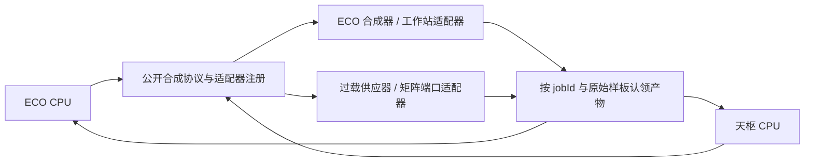

# ECO / AE2LT / Thunderbolt 合成互通方案

状态：源码审查与接口提案，尚未实施互通改造或完成游戏内验收。

## 1. 结论与边界

建议由三个仓库共同维护公开合成协议，双方通过注册适配器接入。ECO 与天枢继续拥有各自的规划、批量增长、线程预算和机器规则；协议负责表达能力、移交材料、报告实际接受量、认领产物和通知任务结束。

消除双方跨项目 Mixin 的条件是：把现有注入点承担的行为完整迁到公开调用点，并同时覆盖存档恢复与取消。直接删除注入、重新启用旧批量接口，均不足以完成迁移。

本次基线：

| 仓库 | 已刷新远端后的 main | 源码版本 |
| --- | --- | --- |
| NeoECOAEExtension-1.21.1 | `daba20fa2` | `21.2.7`，保留当前工作区已有修改 |
| AE2-Lightning-Tech-Reborn | `7c76557f` | `2.1.2-beta3` |
| Thunderbolt-Core-Reborn | `bfb53ac` | `2.0.3-beta2` |

三个本地 main 均与 origin/main 相同。Thunderbolt 的 origin/alpha 另有规划与大整数分片改动；本提案涉及的公开批量 API、compat 适配器和批量执行目录与 main 相同。

玩家反馈尚缺装包版本和失败配方。“ECO 用不了天枢的东西”暂覆盖天枢矩阵端口、过载供应器及任务回收；不能据此认定所有普通配方均无法互通。

## 2. 当前已确认的断点

### 2.1 过载产物适配仍指向旧 ECO 兼容壳

AE2LT 的 `ECOCraftingCpuLogicMixin` 注入 `cn.dancingsnow.neoecoae.api.me.ECOCraftingCPULogic`，并反射读取旧版 job、inventory、cpu 和时间统计类型。

当前该类只保留二进制兼容壳及不执行的注入锚点。真实实现位于 `crafting.execution.ECOCraftingCPULogic`，重写了 insert、执行和持久化方法。旧壳也不再包含 Mixin 完整反射契约所需的字段，因此旧处理器的可用性检查不能建立当前执行路径。

ECO 的部分加工批量路径虽然调用 `Ae2LtCraftingIntegration.prepareOverload` / `registerAccepted`，但这只登记预期产物。当前 ECO 真实 insert 路径按自己的等待库存处理产物，没有经过上述旧 Mixin 的过载认领逻辑。登记、认领、保存、恢复、结束清理尚未构成完整闭环。

具体后果：样板按某个带组件的键登记等待，机器按 ID_ONLY 规则返回同物品 ID、不同组件的键时，普通精确等待项不会自动被满足。这足以解释一类“已经生产但订单不完成”的过载问题；它不是对所有过载故障的游戏内复现。

证据：

- [AE2LT 旧 ECO Mixin](../../AE2-Lightning-Tech-Reborn/src/main/java/com/moakiee/ae2lt/mixin/thunderbolt/ECOCraftingCpuLogicMixin.java)
- [ECO 兼容壳](../src/main/java/cn/dancingsnow/neoecoae/api/me/ECOCraftingCPULogic.java)
- [ECO 当前 CPU 实现](../src/main/java/cn/dancingsnow/neoecoae/crafting/execution/ECOCraftingCPULogic.java)
- [ECO 过载登记桥](../src/main/java/cn/dancingsnow/neoecoae/compat/thunderbolt/ECOOverloadCpuAccountingBridge.java)

### 2.2 天枢合成能力存在，但未接入当前 ECO 发配器

AE2LT 矩阵端口实现 `TianshuSynthesizer`，过载供应器实现 `LightningBatchProvider`。ECO 也有 `ECOAe2LtBatchCapability` 来适配这两种接口。

当前 `ECOProcessingPatternDispatcher.Contract.forProvider` 只接入 Mek-E 的队列接口，明确排除 Thunderbolt / AE2LT 原生批量契约。`ECOAe2LtBatchCapability` 在生产代码中没有调用方。相应测试也明确要求不能通过原生批量契约覆盖 ECO 的倍率策略。

ECO 当前改用 `ECOAe2LtDirectDispatch` 反射过载供应器的内部传输实现，但该专用路径不覆盖矩阵端口。普通单份回退是否适用，还取决于具体样板种类和端口行为，需用失败配方继续验证。

这说明应增加“由调用 CPU 决定批量份数”的公开传输入口。直接把旧适配器接回去，会重新引入双方倍率/自适应策略叠加的问题。

证据：

- [ECO 当前加工发配器](../src/main/java/cn/dancingsnow/neoecoae/crafting/execution/ECOProcessingPatternDispatcher.java)
- [未接通的能力适配器](../src/main/java/cn/dancingsnow/neoecoae/compat/ae2lt/ECOAe2LtBatchCapability.java)
- [过载供应器内部传输适配](../src/main/java/cn/dancingsnow/neoecoae/compat/ae2lt/ECOAe2LtDirectDispatch.java)
- [天枢合成接口](../../AE2-Lightning-Tech-Reborn/src/main/java/com/moakiee/ae2lt/api/tianshu/synthesis/TianshuSynthesizer.java)
- [禁止覆盖 ECO 倍率策略的测试](../src/test/java/cn/dancingsnow/neoecoae/compat/thunderbolt/ThunderboltRuntimeContractTest.java)

### 2.3 天枢到 ECO 已有公开接口桥，覆盖范围有限

Thunderbolt 已通过 `BatchProviderAdapters` 注册 `NeoEcoFastPathBatchAdapter`，调用 ECO 的 `ECOFastPathFacade.prepareAllocated`。天枢普通批量路径也会进入 Thunderbolt 的 `BatchExecutor`。这一方向并非完全没有接入。

但 `prepareAllocated` 只支持无返还物的 NORMAL 无状态配方。工具耐久、返还容器、状态演化等配方不能据此视为已获得完整批量支持。适配器回退时调用普通 `pushPattern`，该调用不携带 job UUID；当前普通 fallback 测试也不能证明异步工作单元的任务归属、定向产物回收和取消均正确。

天枢还明确让过载样板绕开 `BatchExecutor`，因为它需要自己的逐样板产物登记。后续扩展必须覆盖这一分支，不能只测试普通配方的批量桥。

证据：

- [Thunderbolt 的 ECO 适配器](../../Thunderbolt-Core-Reborn/src/main/java/com/moakiee/thunderbolt/compat/neoeco/NeoEcoFastPathBatchAdapter.java)
- [ECO FastPath 公开入口](../src/main/java/cn/dancingsnow/neoecoae/api/me/ECOFastPathFacade.java)
- [天枢执行与过载分支](../../AE2-Lightning-Tech-Reborn/src/main/java/com/moakiee/ae2lt/crafting/timewheel/Ae2LtTimeWheelCraftingCpuLogic.java)

### 2.4 天枢取消桥已经发生私有字段漂移

`ECOAe2LtCancellationBridge` 假定 `logic.job` 的类型含 `id` 字段。当前天枢实际使用私有 `TimeWheelJob`，保存的是 `CraftingLink link`，没有 `id` 字段。源码及本地 `ae2lt-2.1.2-beta3.jar` 的 javap 输出均确认这一点。

反射契约构造失败后被缓存为不可用，取消通知静默跳过。该桥即使恢复字段读取，目前调用的也只是 `ECOCraftingJobLifecycle.finish`，没有使用会立即唤醒已加载工作单元的 `cancelAndRecover`。

当前桥测试只有“空任务不抛错”，无法发现上述真实类型不匹配。

证据：

- [取消桥](../src/main/java/cn/dancingsnow/neoecoae/compat/ae2lt/ECOAe2LtCancellationBridge.java)
- [ECO 持久任务终态与回收](../src/main/java/cn/dancingsnow/neoecoae/crafting/execution/worker/ECOCraftingJobLifecycle.java)
- [取消桥现有测试](../src/test/java/cn/dancingsnow/neoecoae/compat/ae2lt/ECOAe2LtCancellationBridgeTest.java)

## 3. 推荐的接口归属

沿用 Thunderbolt 已有的 `api.crafting` 与适配器注册机制，补全公共协议；实现继续留在各自仓库。API 可随 Thunderbolt JAR 发布，并提供只含接口的编译制品。

- **Thunderbolt**：批量协议、适配器注册、任务上下文、回执与能力版本。公共类型只依赖平台/AE2 API。
- **AE2LT**：公开过载供应器受控传输、矩阵端口合成、过载匹配及其持久化实现。
- **ECO**：保留 `ECOFastPathFacade`、工作站/合成器规则和产物认领入口；在可选兼容入口注册公共协议适配器。

建议把 Thunderbolt 中直接依赖 ECO 的适配实现迁到 ECO 的可选兼容包。Thunderbolt 只调用注册的能力，便可移除其对 ECO 旧发布版的编译依赖；ECO 对 Thunderbolt API 使用 compileOnly，并在检测到对应 Mod/API 版本后加载兼容入口。单装 ECO 仍应正常工作。

平台无关的 NeoECOAE 核心保持现有边界；含 Level、AEKey、IPatternDetails 的协议属于平台集成层。

## 4. 必须补齐的协议

以下新接口名称为设计示意，不表示当前已经存在。

### 4.1 受控批量传输与能力查询

基于已有 `IBatchCraftingProvider` / `PreparedBatch` / `BatchProviderAdapters` 扩展，公开 `prepareTransport` 一类入口。ECO 调用时已经选定 maxCopies，AE2LT 负责自己的目标选择、阻塞检查、无线传输、溢出托管和保存。

准备结果必须明确：是否支持、暂时忙碌、最大安全接受量、能力版本、失效条件。拒绝原因区分 UNSUPPORTED、BUSY、VERSION_MISMATCH，不能统一吞成 null 或长期无声重试。

普通配方可使用原有借用单份模板的约定。需要工具、容器或状态演化的配方，则通过准备结果明确输入总量、返还物与输出总量，CPU 按该结果分配材料。仅把它们转成“每份输入乘 N”不能构成正确支持。

提交至少返回明确的 ACCEPTED / PARTIAL / REJECTED；不确定是否移动过资源时进入独立的 INDETERMINATE 处理路径。回执要验证 accepted + unaccepted = offered，并记录接受后的材料归属。仅在确定零接受时才能普通回退或退款。

### 4.2 保留各自倍率与费用归属

| 行为 | 负责方 |
| --- | --- |
| ECO 的批量增长、探测频率、访问次数与线程预算 | ECO CPU |
| 天枢的时间轮、T 预算与原生批量调度 | 天枢 CPU |
| 目标机器能接收多少、传输缓冲和无线背压 | 供应器 / 机器 |
| CPU 材料提取、CPU 能量预留及任务等待账 | 当前 CPU |
| 供应器自身传输费用、机器自身加工费用 | 对应供应器 / 机器 |

每一类费用只由其所有者结算一次。改造时应对照当前账本保留费用数额与来源，并验证部分接受时的退款范围，不能把不同类别的费用未经核实合并或取消。

互通本身不应提高机器额定吞吐或覆盖 ECO 自适应倍率。补齐状态配方与返还物协议后，部分现有单份回退有机会获得批量执行；具体提升需要实测，不能提前承诺倍数。

### 4.3 过载样板语义与实际产物认领

现有 Thunderbolt 的包装/匹配接口、ECO 的样板语义注册，以及 ECO 已公开的 `ECOCraftingOutputClaimSink` 可以复用。

协议应分别保留：原始样板身份、供应器查找身份、当前执行视图。放大执行视图不应覆盖原始身份；也不能只依靠 getDefinition 或反射方法名/参数个数寻找执行契约。

过载处理使用完整的公开扩展生命周期：

1. 发配前验证 host、匹配规则和输出登记是否有歧义。
2. 按真实接受份数登记预期输出。
3. 入库时将 expectedKey 与 actualKey 分开，由过载账本证明二者对应关系。
4. CPU 通过产物认领接口一次性更新等待账、剩余订单量、交付和本地余量。
5. 扩展账本随 CPU 的任务数据保存、恢复，并在任务结束时清理。

ID_ONLY 认领必须受本任务、本样板、已登记数量与声明规则约束。不能把整个 CPU 的键比较改成忽略组件。

当前 `prepareOverload(Object cpuLogic, ...)` 可以作为迁移起点，但后续公开上下文应提供稳定 jobId 和明确扩展状态，避免用私有逻辑对象及其字段布局充当契约。

### 4.4 任务归属、普通回退与结束通知

新增公开任务上下文/结束监听入口，包含 jobId、所属服务端、CPU/接收端身份，以及完成、取消、失败等结束原因。普通单份回退同样携带该上下文。

天枢在清理 job、waitingFor 和库存之前发出结束通知。ECO 对取消/失败先持久化终态，再通过 `cancelAndRecover` 回收已加载工作单元；卸载的工作单元重载时读取持久终态。完成路径按成功语义释放剩余产物。

所有权不明的提交不能伪装成普通取消后自动重新发送。需要暂停并核对已接受工作、库存和回执，确认后再恢复或回收。

当前 LightningBatchProvider / TianshuSynthesizer 的 nonce 回执仅在实例内缓存，不能证明跨卸载或重启幂等。异步接口若要允许恢复后重试，必须持久化任务/提交身份及可核对回执。跨 CPU 和机器存档也不能仅凭 UUID 声称原子提交。

### 4.5 存储 IO 扩展入口

若目标是删除双方全部跨项目 Mixin，过载 IO 端口的两处注入也要迁移。AE2LT 可公开可注册的 cell resolver，使输入过滤、菜单槽位和实际读写共用一次能力判断；ECO 注册自身存储单元解析器，保留精确容量语义。

## 5. Mixin 迁移清单

| 当前实现 | 迁移目标 |
| --- | --- |
| AE2LT `ECOCraftingCpuLogicMixin` | 公开的发配登记、产物认领、任务扩展存档与结束回调 |
| ECO `Ae2LtTimeWheelCraftingCpuLogicMixin` | 天枢公开任务结束通知 |
| ECO `Ae2LtIOPortBlockEntityMixin` | 公开 cell resolver / 能力过滤 |
| ECO `Ae2LtIOPortMenuMixin` | 菜单与实体共用 cell resolver |
| ECO `ECOThunderboltWorkstationProviderMixin`，当前注入自身类 | 工作站注册式批量适配器 |
| ECO `ECOThunderboltProviderMixin`，当前未启用 | 清理过期实现，使用注册式适配器 |
| ECO `ECOAe2LtDirectDispatch` 的私有字段/方法反射 | AE2LT 公开受控传输入口 |

这是双方所有者可共同消除的依赖。针对原版 AE2 的必要集成 Mixin 另外审查。ECO 旧兼容壳还有第三方使用者，不能因删除双方适配而一并移除所有兼容壳。

## 6. 实施顺序与验收

1. **补真实契约回归**：覆盖当前天枢实际任务类型、ECO 当前 CPU 实现、ID_ONLY 实际产物和正向取消通知，避免继续只测旧类存在或空任务不抛错。
2. **补协议、双方接入**：先让受控传输、任务上下文、认领及扩展存档形成闭环；每次提交只由一套入口负责登记与结算。
3. **迁移普通回退及状态配方**：工作单元保留 jobId，状态/容器/耐久配方使用其明确的材料准备结果。
4. **成组删除旧实现**：删除双方跨项目 Mixin、反射私有实现及其配置；公布支持新协议的最小配对版本。旧版本能力不完整时，在接收材料前给出明确原因。
5. **加架构约束和实际验收**：扫描双方 Mixin 配置及字节码目标，禁止互相目标化；兼容包只能使用公开 API，禁止读取对方私有字段。验证缺任一可选 Mod 时仍能启动。

核心验收矩阵：

| CPU → 执行端 | 基本发配 | 部分接受/背压 | 产物归属 | 取消/拆除 | 卸载/重启 |
| --- | --- | --- | --- | --- | --- |
| ECO → 本方 F/FX/工作站 | 必测回归 | 必测 | 必测 | 必测 | 必测 |
| ECO → 过载供应器 → 普通/无线目标 | 必测 | 必测 | 必测 | 必测 | 必测 |
| ECO → 天枢矩阵合成端口 | 必测 | 必测 | 必测 | 必测 | 必测 |
| 天枢 → ECO F/FX/工作站 | 必测 | 必测 | 必测 | 必测 | 必测 |

配方维度包含普通合成、多输出、返还容器、工具耐久、ID_ONLY 输入/输出、重复样板及工具/种子状态演化；大订单另测 long 边界与精确数量。并发两个等待相同产物的任务，确认不会串单。取消要覆盖工作单元完成的同一 tick，分别检查已加载与卸载工作单元。

自动化验收检查材料、输出、返还物和各类能量的守恒。游戏内验收检查真实接线、背压、卡单恢复及吞吐；单元测试通过不能代替游戏内结论。

## 7. 本轮验证结果

- ECO 当前工作区对本地 AE2LT `2.1.2-beta3` JAR 运行 `compat.ae2lt.*` 与 `compat.thunderbolt.*`：45 项通过。
- Thunderbolt 当前 main 使用本地 ECO `21.2.7` JAR 替换默认 `21.2.0-beta3` 依赖，运行 `compat.neoeco.*`：13 项通过。替换配置位于其被 Git 忽略的 `build/interop-audit-current-eco.init.gradle`，未修改正式依赖声明。
- javap 检查本地 AE2LT beta3 JAR 的实际 `TimeWheelJob`：存在 link，不存在 id，与取消桥不匹配。
- 以上测试没有覆盖本提案列出的完整游戏互通矩阵。没有进行客户端操作或宣称玩家反馈已经修复。

本轮交付为此方案文档与上述源码/现有测试核对，没有修改双方发配机制。
