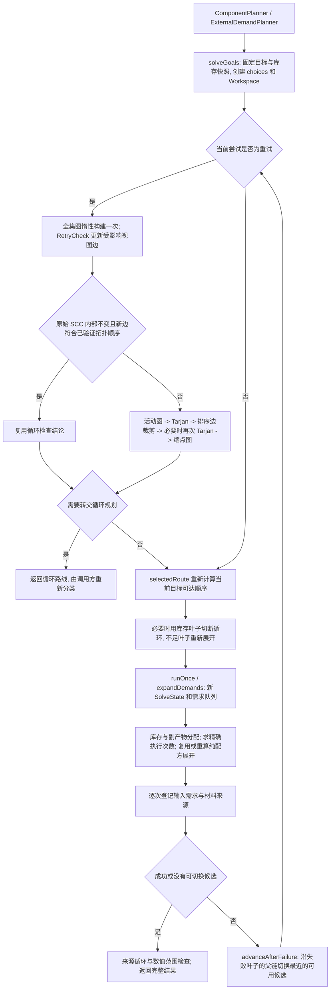

# ECO 无环规划重试优化与验证

2026-11-10，1.20.1 工程，基线提交 `a32fe8f330b8b34452ee19b209ad1f33fcd15eb4`。

已实现调用内的活动图检查复用和纯配方数量展开缓存。多次重试的固定材料链减少了重复建图、SCC 分析和对象分配。旧星门导出回放虽然减少了建图和分配，但没有测到稳定的总耗时改善；本次不能宣称玩家的 4–9 秒等待已经解决。

## 1. 根因及实际调用路径

此前 19 笔慢单的 6,375 个主要请求样本中，68.14% 位于无环材料展开和数量计算，30.04% 位于活动图重建与分析。这是 JFR 执行采样占比，不是精确的墙钟耗时分摊。原始监控记录见 [现场分析](<E:/Minecraft Project/NeoECOAEExtension-1.20.1/build/validation/live-planning-20261110-0143/SUMMARY.md>)。

修改前已逐项阅读 `solveGoals`、`advanceAfterFailure`、`selectedRoute`、库存切断循环、`runOnce`、`SolveWorkspace`、`JointOutputDemandQueue`、来源账本、`PatternDependencyEdges`、Tarjan 和缩点图；审阅记录见 [修改前数据依赖分析](<E:/Minecraft Project/NeoECOAEExtension-1.20.1/build/validation/acyclic-retry-20261110/ANALYSIS.md>)。

以下是修改后的真实重试关系。修改前，图检查处每次都执行完整的 `selectWithChoices`，每次材料展开也都重新计算配方原始输入、输出数量。



原始全集图一直是每次 `solveGoals` 只惰性构建一次。重复成本来自：一个候选索引变化后，活动图及分析被整体重建，而材料账本、需求队列、来源分配和纯配方算术都重新执行。`SolveWorkspace` 原来只有库存和 choices 两个引用，替换这个包装对象本身不是主要成本。

`advanceAfterFailure` 每次只增加一个选择索引，不回退；这里没有新增候选去重或剪枝，也没有把不同物理配方按材料名字合并。保留原有候选尝试顺序及搜索覆盖能力。

## 2. 数据依赖与安全复用边界

| 数据 | 重试之间的变化 | 本次处理 |
| --- | --- | --- |
| 编译网络、配方输入/输出和特殊槽位契约 | 同一调用的编译快照内固定 | 复用候选列表、物理配方视图索引和纯数量展开 |
| 目标、原始库存、延后求解配方集合 | 同一调用内固定 | 共享只读上下文，消耗账本每次重新创建 |
| choices | 失败后切换候选 | 比较实际选中的 CompiledPattern 对象，更新相关视图边 |
| SCC 内部结构 | 可能变化 | 只有通过保守证书才能复用；否则完整重算 |
| 普通输出数量、输入槽位数量 | 只依赖编译配方和本次精确执行次数 | 有界缓存，执行次数变化后重算 |
| 库存剩余、可用副产物、来源分配、特殊输入结果 | 受到共享分支、消耗顺序和前序供给影响 | 不缓存，逐次重新计算 |
| 当前可达材料顺序、需求队列 | 可随候选和库存叶子变化 | 继续按当前状态重建 |

因此，本次没有做“按材料名＋需求量缓存整个子问题”，也没有进行局部库存回滚。这样的缓存缺少共享库存、旁路副产物、特殊输入、来源顺序等上下文，可能少算材料或产生无法启动的供给循环。

## 3. 修改文件与实现

| 文件 / 关键方法 | 修改 |
| --- | --- |
| [AcyclicCraftingSolver](<E:/Minecraft Project/NeoECOAEExtension-1.20.1/src/main/java/cn/dancingsnow/neoecoae/crafting/planner/solve/AcyclicCraftingSolver.java:97>)：`solveGoals`、`runOnce`、`expandDemands`、`solveStockBackedRoute` | 每个调用复用一个 Workspace；接入重试图检查和纯展开缓存；每次 `runOnce` 仍创建独立 SolveState |
| [ActiveRouteSelector](<E:/Minecraft Project/NeoECOAEExtension-1.20.1/src/main/java/cn/dancingsnow/neoecoae/crafting/planner/solve/ActiveRouteSelector.java:396>)：`RetryCheck`、`analyze` | 复用未改变的配方视图边；保存未裁剪的原始 SCC 分区；用已验证的拓扑顺序证明是否可以跳过整图分析 |
| [SolveWorkspace](<E:/Minecraft Project/NeoECOAEExtension-1.20.1/src/main/java/cn/dancingsnow/neoecoae/crafting/planner/solve/SolveWorkspace.java:32>)：`cachedExpansion`、`outputAmounts`、`inputAmount` | 在发生重试后才启用缓存；每个编译配方只保留最近一次执行次数的展开；缓存和未缓存路径共用数量公式 |
| [AcyclicSolveMetrics](<E:/Minecraft Project/NeoECOAEExtension-1.20.1/src/main/java/cn/dancingsnow/neoecoae/crafting/planner/solve/AcyclicSolveMetrics.java:5>) | 每次调用独立的可选计数与计时，结束时汇总 |
| [ECOPlanningStageLogger](<E:/Minecraft Project/NeoECOAEExtension-1.20.1/src/main/java/cn/dancingsnow/neoecoae/crafting/planner/ECOPlanningStageLogger.java:50>) | 复用现有日志开关和请求上下文，完整输出统计字段，不受旧诊断文字长度截断影响 |
| [ActiveRouteSelectorTest](<E:/Minecraft Project/NeoECOAEExtension-1.20.1/src/test/java/cn/dancingsnow/neoecoae/crafting/planner/solve/ActiveRouteSelectorTest.java>)、[AcyclicStockRouteTest](<E:/Minecraft Project/NeoECOAEExtension-1.20.1/src/test/java/cn/dancingsnow/neoecoae/crafting/planner/solve/AcyclicStockRouteTest.java>) | 在现有测试类中补充 9 项回归，包括随机图差分和并发求解 |

**活动图复用的证明与失效条件。**

边按“提供配方的视图”保存，而不是按边的起点保存；副产物排序边的起点可能属于另一个材料。切换某个视图后，同时使旧、新物理配方的所有潜在视图失效，重新计算它们的依赖锚点。物理配方匹配沿用已有 `equals` 语义。

完整分析后保存原始 SCC 分区，并实际检查全部跨 SCC 边是否符合 Tarjan 编号的拓扑顺序。下一次变化只有满足以下条件才复用循环检查结论：涉及的视图不在原始循环 SCC 中；被替换的旧边不是 SCC 内部边；所有新边端点都已知，且严格遵守已验证的跨 SCC 顺序。

这些条件保证旧 SCC 内部连接不变，而且跨 SCC 边无法组成新环。原始 SCC 内部的材料边和排序边没有变化，因此排序边裁剪及循环配方判断也不变。缓存只返回这个检查的布尔结论，不发布会继续变动的图或 Selection。

涉及循环成员、改变内部边、出现未知节点、违反既有拓扑顺序时，回退到原来的完整分析。即使新路线实际上无环，只要证书不能证明，也会重算。证书基于**未裁剪的原始 SCC**，避免把旧排序环后来变成的材料循环漏掉。取消、预算异常或其他运行异常会清除部分更新状态，不缓存未完成的分析。

**纯数量缓存的键与失效条件。**

使用 `IdentityHashMap<CompiledPattern, Expansion>`，键是编译配方对象身份，每个条目同时检查精确 `PlannerAmount times`。不同视图、不同编译配方不能混用；执行次数变化时替换旧展开。缓存只保存聚合输出数量和普通输入槽位数量；可复用输入仍按原规则不乘执行次数，特殊输入继续由原解析器每次处理。

缓存最多保留 65,536 个量值槽位，包含执行次数及输入、输出槽位的计数。超过上限的新条目走原公式，已有条目只替换最近的次数；这不是对 BigInteger 字节数的硬上限。输出映射只读，数组不向调用方暴露，数量对象不可变。缓存随本次调用结束释放，不跨订单、不跨线程。

## 4. 性能统计

沿用现有 `ecoPlanningStageDebug` 开关，默认关闭。本轮没有修改整合包运行配置。正常规划服务开启该开关后，每次 `solveGoals` 结束产生一条 `[ECO-PLANNER-STATS]`、`stage=acyclic_retries` 汇总，带请求 ID、目标、数量及状态。一个玩家请求可能有多次边界求解，因此应按请求 ID 聚合。

| 字段 | 含义 |
| --- | --- |
| `elapsedMs`、`attempts`、`switches` | 本次调用耗时、候选尝试次数、实际切换次数 |
| `universeBuilds/Ms` | 原始全集图构建次数和耗时 |
| `graphBuilds/Ms`、`prunedGraphBuilds/Ms` | 活动图实际构建次数及维护/构建耗时、裁剪图构建统计 |
| `sccPasses/Ms`、`condensationBuilds/Ms` | 活动图直接 Tarjan 调用和缩点图构建统计，包含裁剪后的再次 Tarjan |
| `runOnce/Ms` | 实际数量求解轮数及累计耗时；库存叶子重开可能使其多于候选尝试数 |
| `materialVisits`、`patternExpansions`、`inputExpansions` | 处理正需求的材料次数、配方逻辑展开次数、普通输入槽位处理次数 |
| `graphCacheHits`、`graphInvalidations` | 图检查结论复用次数及需要重新完整分析的次数 |
| `edgeRowsReused/Rebuilt` | 复用和重算的配方视图边行数 |
| `expansionCacheHits/Misses`、`expansionInvalidations`、`expansionCacheBypasses` | 纯数量缓存命中、未命中、次数改变、容量旁路次数 |

`patternExpansions` 仍包括缓存命中后的账本处理，不能把它解释成实际乘法次数。本报告的“纯配方展开重算次数”是 `patternExpansions - expansionCacheHits`，不是完整材料子问题的重算次数。关闭统计时不创建 Metrics、不进行各阶段计时、不拼接汇总文字；没有逐材料节点日志。

另做了公开求解入口的开关冒烟验证：启用时输出完整的一条统计（3 次尝试、2 次切换），随后关闭时不输出统计，退出 Scope 后没有上下文残留，见 [stats-smoke.log](<E:/Minecraft Project/NeoECOAEExtension-1.20.1/build/validation/acyclic-retry-20261110/stats-smoke.log>)。这条冷启动验证的耗时没有用于下表的性能结论。

统计范围限定在这次求解及直接图分析。`CycleStructure` 裁剪时的内部材料核辅助 Tarjan 没有另计入 `sccPasses`；初始索引准备、证书建立、选定路线排序及其他代码也计入总耗时，分项不应被当成覆盖全部代码的精确耗时分摊。

## 5. 正确性与构建验证

Java 17 编译、规划与精确数量测试、JAR 构建均通过。统计版基线为 458 项：457 通过、1 跳过；修改后为 **467 项：466 通过、1 跳过，0 失败、0 错误**。跳过的是原有 `TechModPlannerChallengeTest.plannerHandlesAnIndependentlyProvenPlayerOrder`，没有为了本次优化禁用测试。

新增保护包括：相同拓扑的候选切换后确实命中图缓存；新反馈边强制重算；排序环转成材料环；同一物理配方多个输出视图的锚点变化；中途取消后的重新检查；24 组随机图、每组 35 次候选变化，共 840 次与原 `selectWithChoices` 完整分析的差分比较。

数量回归包含一个共享中间材料的三候选订单：候选逐次产出 1、2、3 个副产物，另一路配方执行次数必须随之从 3、2 变成 1。还覆盖额外目标共享库存、全部候选失败的最终缺料、`2^62` 级目标导致中间需求超出 long、同一 solver 并发及连续处理不同库存和数量。既有测试继续覆盖单配方、多层依赖、库存不足、循环/SCC、特殊输入和候选依赖范围变化。

验证命令从项目目录执行：

```powershell
.\build-local.ps1 -GradleArguments @(
  'test', '--rerun',
  '--tests', 'cn.dancingsnow.neoecoae.crafting.planner.*',
  '--tests', 'cn.dancingsnow.neoecoae.crafting.amount.*', 'jar',
  '--init-script', 'build/validation/acyclic-retry-20261110/verification.init.gradle',
  '--project-cache-dir', 'build/validation/acyclic-retry-20261110/gradle-state',
  '--offline', '--console=plain', '--max-workers=2'
)
```

Gradle 串行执行，输出隔离在本次 validation 目录。构建日志见 [validation.log](<E:/Minecraft Project/NeoECOAEExtension-1.20.1/build/validation/acyclic-retry-20261110/validation.log>)，测试 XML 已另存至 [verified-test-results](<E:/Minecraft Project/NeoECOAEExtension-1.20.1/build/validation/acyclic-retry-20261110/verified-test-results>)。实际验证时未指定独立 project cache；后续一次默认目录构建后，本次临时 main class 目录已被清理，因此上面的复测命令额外指定独立 `--project-cache-dir` 来隔离构建历史，基准改用独立的编译快照。原测试与 02:48 已完成的测量记录完整保留。

[构建产物 neoecoae-20.5.6-acyclic-retry.jar](<E:/Minecraft Project/NeoECOAEExtension-1.20.1/build/validation/acyclic-retry-20261110/neoecoae-20.5.6-acyclic-retry.jar>) 包含新增的 RetryCheck、Expansion 和 Metrics 类；求解器 class major version 为 61。SHA-256：`5BAED8CF8A34077407EB9207BDF16E628DAC4890AD7F6E5B74BDFA2045CFA81D`。这是当前工作区构建，包含原有未提交改动；本任务没有安装它，也没有把构建成功当作游戏内验证。

## 6. 性能对照

环境：Windows、AMD Ryzen 9 7845HX、Microsoft OpenJDK `17.0.10+7-LTS`，同样的 `-Xms512m -Xmx2g`。基线是在优化前加入同一套统计的源码和编译类，保存在 `baseline-src` 和 `baseline-classes`；两个版本的 planner 字节码差异限定在本次修改的求解器、活动图选择器、Workspace 及嵌套类。优化版快照保存在 `optimized-classes`，从当时构建的、未经重映射的 dev JAR 恢复，供后续复测使用。

每个版本、每个工作负载使用 3 个独立 JVM，每个 JVM 测量 12 次，共每组 36 次、总共 288 次。合成链先预热 30 次，旧星门回放先预热 20 次；三个对照批次的执行顺序为基线→优化、优化→基线、基线→优化。机器存在运行波动，保留所有批次及 P95，没有挑选最快一轮。

计时范围是实际执行 `solveGoals` 的内部求解入口，包含其中的重试和惰性全集图构建；不包含 Minecraft 启动、编译网络、调用方首次路线分类、最终界面传输。两边都启用相同计数，通过局部测量入口读取统计，避免每次打印日志干扰测量。结果规范化和校验发生在计时范围之外。

线程分配量通过 `ThreadMXBean.getThreadAllocatedBytes` 的前后差值测量，是累计分配字节，不是存活堆大小。采用 `ECOCancellation.NONE` 完整执行相同求解工作，不施加墙钟取消条件；候选重试上限仍遵循原有规则。

| 工作负载 | 尝试次数 | 中位耗时：基线 → 优化 | P95：基线 → 优化 | 每次分配 MiB：基线 → 优化 |
| --- | ---: | ---: | ---: | ---: |
| 单次成功，512 层固定链 | 1 → 1 | 2.99 → 2.90 ms | 6.27 → 4.65 ms | 2.22 → 2.22 |
| 512 层固定链，48 个候选，最后成功 | 48 → 48 | 55.89 → 37.61 ms | 62.71 → 62.24 ms | 140.66 → 71.84 |
| 512 层固定链，48 个候选全部失败 | 48 → 48 | 56.16 → 34.31 ms | 73.56 → 62.97 ms | 140.32 → 70.50 |
| 旧星门导出中的无环求解 | 4 → 4 | 66.78 → 67.34 ms | 100.25 → 120.51 ms | 80.33 → 69.79 |

| 工作负载 | 活动图 / 直接 SCC / 缩点图次数：基线 → 优化 | 材料访问次数：基线 → 优化 | 纯配方展开重算：基线 → 优化 |
| --- | --- | ---: | ---: |
| 单次成功 | 0 / 0 / 0 → 0 / 0 / 0 | 516 → 516 | 514 → 514 |
| 48 候选后成功 | 47 / 47 / 47 → 2 / 2 / 2 | 24,768 → 24,768 | 24,672 → 1,074 |
| 48 候选全部失败 | 47 / 47 / 47 → 1 / 1 / 1 | 24,768 → 24,768 | 24,672 → 1,074 |
| 旧星门导出 | 3 / 3 / 3 → 2 / 2 / 2 | 10,444 → 10,444 | 9,201 → 4,857 |

旧星门回放有 2,792 个键、2,640 个编译配方、3 个初始循环组件。优化版有 1 次图缓存命中，纯数量缓存命中 4,344 次，执行次数变化失效 254 次。前后均返回 `PLANNED_BUT_AMOUNT_UNREPRESENTABLE`。它保留旧导出的数量和候选顺序，用模拟接口及带标识 NBT 的原版键代替不可用模组对象；不是当前 19 笔慢单的完整世界重现，也没有包括循环求解和整个玩家报告流程。

全部 288 次测量中，同一工作负载的规范化结果一致：状态、精确使用/缺少/发射材料、需求量、配方次数、最终候选、字节估算、诊断、完整来源需求与分配。随机需求 UUID 按注册顺序规范化；HashMap 派生的诊断节点/边按完整字段和重复次数比较，实际材料需求与分配顺序仍逐项比较。

**对性能的结论限定在实际数据内：** 重试很多且大部分结构不变的负载获得收益；仅少量重试的星门旧回放未表现出稳定耗时改善。它的数量求解中位累计时间为 39.84 → 41.07 ms，说明本次保留的材料账本和队列处理仍是主要成本。图分析和分配次数下降不等于整单一定更快，尤其不能直接把局部基准推广成玩家等待时间的降幅。

原始数据和可复测入口：

- [comparison.json](<E:/Minecraft Project/NeoECOAEExtension-1.20.1/build/validation/acyclic-retry-20261110/comparison.json>)：中位数、P95、每个 JVM 的中位数、计数和结果指纹。
- [measurements.json](<E:/Minecraft Project/NeoECOAEExtension-1.20.1/build/validation/acyclic-retry-20261110/measurements.json>)：288 次逐次测量；同目录 `baseline/optimized-*-fork*` 保存原始日志和完整规范化结果。
- [AcyclicRetryBenchmark.java](<E:/Minecraft Project/NeoECOAEExtension-1.20.1/build/validation/acyclic-retry-20261110/AcyclicRetryBenchmark.java>)、[AcyclicExportReplay.java](<E:/Minecraft Project/NeoECOAEExtension-1.20.1/build/validation/acyclic-retry-20261110/AcyclicExportReplay.java>)：工作负载和结果校验。
- [compare-forks.ps1](<E:/Minecraft Project/NeoECOAEExtension-1.20.1/build/validation/acyclic-retry-20261110/compare-forks.ps1>)：串行执行全部对照；结束后运行同目录 `summarize.ps1`。这些是本次本地验证文件，保存在 build 下，清理 build 前需另行保存。

## 7. 剩余热点与边界

每次重试仍完整计算库存消耗、共享副产物、材料来源、特殊输入、当前可达顺序和需求队列；材料访问及候选尝试次数没有减少。拒绝候选的解释节点也仍按原语义生成。下一轮应以实际加载新 JAR 后的计时和采样为依据，细分 `runOnce` 中这些成本，再决定是否复用纯结构索引；不能直接缓存完整材料数量账本。

本次的 SCC 证书保守：触及原始循环组件或打破旧拓扑顺序会完整重算。未实现动态 SCC，也没有为不同物理配方建立未经证明的等价关系。缓存的正确性前提是本次求解使用既有编译网络快照及固定调用参数，不支持外部在计算过程中修改编译配方契约。

本轮没有启动整合包、进入世界或替换运行 JAR，尚无优化后的玩家端 4–9 秒等待对比。现有实际采样作为问题定位证据，局部测试和旧数据回放作为本次计算改动的验证，二者没有混为游戏内实测。

`ECOPlanningService.Request.retainCandidate` / `finish` 的异步返回协议保持原状。独立的后续方案可以在完整材料报告经过数量和来源验证后，提前向确认页交付不可变快照，并单独表示后续可执行路线搜索状态；必须保留最终成功、取消和失败的一致性，不能把尚未验证的中间状态显示为完整报告。本次没有实施该协议改造。
