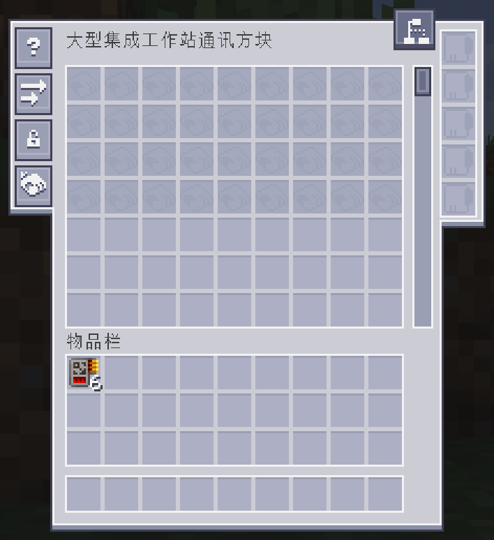

# 1.21.1 增量同步实施记录

日期：2026-10-23。用户已授权按评估文档实施全部约定范围，使本工程行为基本同步 1.21.1。原主体基线仍为 `dc8344f48`，本次增量目标固定为 `c95684c93`；独立清单见 `porting/upstream-sync-2026-10-23.json`。

## 范围与保留合同

- 同步正确性修复、存储扫描与终端精准数量优化、大型工作站温控与批次、七行样板与连续滚动、面板贴图和图集 API，以及相应资源、指南和回归测试。
- 大型工作站继续只有常规、AAE、EAE、AE2LT 四类；保留 ExtendedAE Plus 的其他联动及结构终端，机器 UI 不恢复自动搭建按钮。Bigger AE2、Data Energistics、Applied Generators 等专属实现继续排除。
- 本地 SavedData 架构、20.4.2 旧格式转换、迁移回执和旧回填只读屏障继续保留。
- 温度模式保留实际加工热量、电预热、主动与自然散热的分工；降温临时按 256 分段，原温区恢复后恢复原并行。补批、分段和模式切换均保留已付工作量与进度余数。
- 关闭温度机制时保留原冷却液模式：冻结温度状态，只在实际超频推进时消耗冷却液，缺料、缺电、输出受阻或关闭必要开关时暂停，不重置任务。

## 实施进度

| 部分 | 当前状态 |
| --- | --- |
| 上游增量导入 | 已按变更路径三方合并，导入 130 个源码、测试、指南和资源路径；18 个冲突文件已逐项处理 |
| 正确性与存储优化 | 已完成，相关目标回归通过 |
| 工作站批次与界面 | 已完成，材料、能量、进度余数、降档与恢复及原生菜单回归通过 |
| 面板 API | 已完成实际放置态、按钮状态、档位图集与资源替换；补充 Forge 版 API 文档 |
| 完整主源码编译 | 全部业务源码通过 Java 17 编译，未排除生产源码 |
| 回归测试 | 增量专项 330 项：321 通过、9 条件跳过；原平台 176 项、契约 6 项通过 |
| JAR 与资源检查 | 已通过 JAR 包审计及变更资源字节一致性检查 |
| 客户端、专服与真实交互 | 四阶段专服验证通过；基础及联合客户端菜单与滚动通过；10 类主机及 64 个模型视图通过 |
| 玩家旧世界与普通安装 | 本次尚未执行 |

## 已处理的版本差异

- 模块终端图标改用 1.20 NBT `CustomModelData`，明确保留原图集/模型值 0、1、2、4；模型覆盖仅保留本工程四类。
- AE2 15 不提供新版快捷移动过滤挂点，按实际菜单入口实现玩家到样板/升级槽的转移，保留未接收物品及锁定行检查；返回缓存只隐藏槽位，持久化继续保留。
- 连续滚动的客户端帧推进改接 Forge `ScreenEvent.Render.Pre` 和本工程 LDLib1 菜单桥接。
- 发布版 AE2LT 记账使用实际 1.20 无注册表参数的存档方法；数组样板输出转换成发布契约要求的列表。
- 新增 SupplierStorage invoker 明确关闭 Minecraft 名称重映射，避免将 AE2 私有方法当成原版混淆目标。
- 继续使用本工程的 Java 17 集合、clamp、NBT、Forge 能力和 UI 适配层。
- UI 适配层原按钮只接受左键，已增加按控件声明的鼠标键集合，并在服务端校验。工作站超频按钮允许左/右键；真实客户端已确认右键预热和左键关闭超频。
- 原生 UI 坐标是整数，修正主机标记居中和文字缩放中的整数除法；物品悬停继续传递原生物品上下文。样板界面的长标题按实际字体宽度保留单行，为顶部优先级页签保留位置。
- 增加 `ResourceInstance.getBuiltinProvider(String)`，使附属能按目标版本 API 替换已注册图集；既有图块缓存继续动态解析替换结果。

## 四批行为结果

1. **正确性**：无限域缺少任何原始成员时，缓存视图、组合存储、普通及精准枚举立即封锁，并刷新特殊盘提供者；原旧档转换和回填只读屏障保留。冷却开关同时失效虚拟合成能力与派发容量。普通安全 DAG 允许原生/AAE CPU；定向输出完整归属接收 CPU，余量保留，完成时通知工作站和工作节点。发布版 AE2LT 使用实际可用的记账、任务 UUID 和公平派发入口。
2. **扫描与终端**：复用普通枚举累加器；普通数量优先使用 long；相同透明库存共享只读快照，过滤库存保持独立；仅为无限、超 long 或普通投影不忠实的条目保留精准侧通道。同步失败、来源变化、时间回退与服务器停止的边界均有回归。
3. **大型工作站**：先快后慢升温、电预热与最近 20 tick 实际温度遥测；兼容批次补满；降温后最多 256 次一段，原温区恢复后解除临时分段；`progressRemainder` 和 `segmented` 正常持久化。七行样板、模块终端图标/名称、连续任务滚动、状态颜色、新图集、联动纹理及进度页背景均已适配。
4. **主机面板**：三类主机及计算成员按实际放置态捕获图案；档位名称、徽章、标记、状态灯、五颗按钮和六张完整图集按统一规则解析。旧 UI 工厂和空值回落保留。目标示例见 [HOST_PANEL_API_ZH_CN.md](../HOST_PANEL_API_ZH_CN.md)。

## 回归范围与既有测试迁移欠账

新增 `upstreamSyncTest`，清单为 `porting/upstream-sync-test-sources.txt`。它覆盖本轮范围内的上游变化测试、必要夹具和存储面板状态回归，直接使用完整生产输出及实际锁定的附属 JAR。默认 `test` 未被替换；新增 source set 不裁剪或屏蔽生产业务实现。

330 项中，8 项因锁定 AE2LT/Thunderbolt 发布版不提供更新的 exact streaming / exact admission 接口而条件跳过；1 项是范围外 Data Energistics 的屏幕补丁验证。AE2LT 发布版回落、普通/过载派发、产物与取消链另有实际执行的回归，不能将这 8 项记为已验证的新接口。

三组最终重新执行的结果为：专项 321 项通过、9 项条件跳过，平台适配 176 项通过，生产契约 6 项通过，共 503 项通过。最终编译/JAR 与三组测试串行完成；任务执行与缓存状态保留在日志中。

原整个 `src/test` 导入树还包含未适配的新版 API、注册表/数据组件签名和已裁剪联动，完整 `compileTestJava` 不通过。相关旧测试没有批量改写，也没有删除以取得成功；本次声明的是专项与平台/契约通过，不是默认全量测试通过。

## 实际运行与验收边界

基础环境专服使用 `run/base/server` 下新建的两个专用验收世界，端口 25596。分别执行：

- `legacy2042Smoke=upgrade/read`：旧盘身份、完整物品 NBT、超 long 无限数量、迁移回执、样板高槽位、旧文件字节和不可信回填屏障经升级及冷重启验证。
- `storageSavedDataSmoke=write/read`：普通盘、精准大数、迁移/回填、中断恢复、重复身份及缺失已发布文件等保护经写入和冷重启验证。

客户端分别使用 `portingProfile=base` 与 `combined` 的真实 Forge 环境，联合环境加载 AAE、EAE、EAE Plus、AE2LT 及必要前置。新增开发探针 `upstreamSyncSmoke` 经原生菜单包和真实屏幕鼠标入口验证：

- 容量卡 Shift 点击安装 4 张，背包保留 2 张，返回缓存未接收卡片；服务端和客户端都扩展到 72 槽。
- 七行视口可见 63 槽；拖动滚动条新增的左边缘可以到达第八行。
- 右键启用预热并开启超频、关闭主动冷却；左键关闭超频后停止预热，均以服务端状态确认。
- 对通过生产存档读取器创建的 12 条任务夹具，半行滚动、跨页拖动、卡片命中和视口裁剪正常；滚动后任务数量及已付进度余数 123 保留。
- 新增 `SupplierStorage` invoker 在真实 Forge Mixin 环境存在并可调用。
- 通讯接口两侧控件使用连续的侧翼外框，顶部抬起的优先级页签经原生鼠标入口点击，确实进入 AE2 `PriorityScreen`。

任务夹具用于检验服务器快照、客户端布局和交互，不等同于整条实际配方执行；加工守恒、降温恢复和输出路由的证据来自专项回归。模型工作状态同样是外观夹具，不能当作配方完成证明。

联合环境日志中仍有锁定附属发布包的非致命资源错误：AAE 无线终端配方缺少 `ae2wtlib:combine` 序列化器，Curios 标签引用未注册的量子终端物品，EAE 的 EMC 接口战利品引用未注册的接口物品。这些附属内容未纳入本轮通过声明；本工程菜单、探针 PASS 与截图证据分别记录。

玩家已有世界升级和普通启动器安装本轮未执行。上游 Java 21 / AE2 19 的性能数值未移作本工程 Java 17 / AE2 15 的 TPS 或耗时结论。

## 通讯接口整套 1.21.1 素材

按用户追加要求，通讯接口完整采用高版本的背景、样板区、滚动滑块、按钮底框/图标、优先级按钮和槽位素材。NeoECOAE 自身背景来自固定增量 `c95684c93`；公共控件素材和绘制参数锁定为其依赖的 AE2 `neoforge/v19.2.18`，提交 `db17504a86128fdf3dae31f5fb7a112a646e0b93`。

现有本地 `states.png` 已与该版本原文件字节一致，本轮将原生 AE2 15 图标实际接入该图集，并处理变化的裁剪矩形和优先级图标。补入启用/禁用滑块的原 PNG；按钮栏使用高版本 6 像素按钮间隔，按钮覆盖普通、悬停、聚焦及禁用表现。升级槽使用主背景图集中的原始 18×18 格子，与样板和背包保持同一边框与底色。

渲染替换仅在大型工作站通讯接口屏幕生效，菜单槽位身份、设置回调、工具提示、Shift 操作与网络包继续由原生 1.20.1 实现处理。附属预先创建的升级面板替换为使用统一图集的展示控件，仍绑定同一组原生升级槽。

最终布局以用户提供的参考截图为准：主面板保留原始 188×245 尺寸，两侧向外伸出并连接主体，下半部分保持收窄轮廓，整体包围盒为 228×245。左右侧翼与主体共用背景色、白色内缘及底部阴影，连接处删除主体的重复竖边。左侧按钮从 `(4,4)` 开始，右侧升级槽从 `(207,6)` 开始；优先级页签恢复到主体顶部 `(184,-5)`。样板与背包仍按相同列对齐。

原始高版本背景另行保留，派生主底图及按钮侧翼图集由 `tools/porting/compose_workstation_interface_artwork.py` 可重复生成，不缩放原始槽位及控件像素。按钮侧翼按实际可见按钮数量伸缩，基础环境的四颗按钮与联动环境增加按钮后的轮廓均能连续连接主体。专项回归检查连接处没有重复竖边，以及侧翼结束后两边恢复透明。

AE2 15 使用 `verticalToolbar` 注册按钮栏，升级展示控件使用 `widgets.upgrades` 定位并会覆盖 `slots.UPGRADE` 的初始位置，因此两组实际控件位置都必须在本屏幕 JSON 中显式声明。回归同时检查合并后的控件样式、原生槽位位置和视口命中；开发客户端检查控件实际处于主框内部。

素材来源、哈希和代码来源见 `porting/workstation-interface-artwork-1.21.1.json`。JAR 中附带原素材署名及对应授权声明。新增五项回归检查原文件字节、三态按钮矩形、升级槽/侧栏几何、生效屏幕范围与连续侧翼轮廓；真实客户端另保存普通、悬停、聚焦和禁用状态截图。



## 可重复命令

所有 Gradle 命令通过 `build-local.ps1` 串行执行：

```powershell
.\build-local.ps1 upstreamSyncTest portingPlatformTest portingContractsTest jar --console=plain
.\build-local.ps1 runClient -PportingProfile=combined -PclientSmoke=true -PupstreamSyncSmoke=true --console=plain
.\build-local.ps1 runClient -PportingProfile=base -PclientSmoke=true -PupstreamSyncSmoke=true --console=plain
.\build-local.ps1 runClient -PportingProfile=combined -PclientSmoke=true -PclientSmokeInventories=true --console=plain
.\build-local.ps1 runClient -PportingProfile=combined -PclientSmoke=true -PworkstationModelSmoke=upstream-sync-20261023 --console=plain
python -X utf8 tools/porting/audit_package.py --output porting/package-validation-upstream-sync-2026-10-23.json
python -X utf8 tools/porting/record_upstream_sync_evidence.py
```

专服写入/升级阶段要求全新的专用世界，读取阶段复用同一世界；不能对玩家世界使用这些开发夹具。日志位于 `validation/upstream-sync-20261023-*.log`，截图位于 `run/combined/client/screenshots/`；最终机器证据和包审计随本次增量清单记录。
