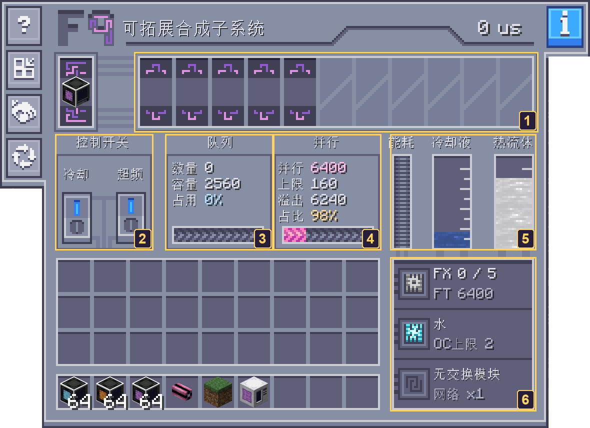
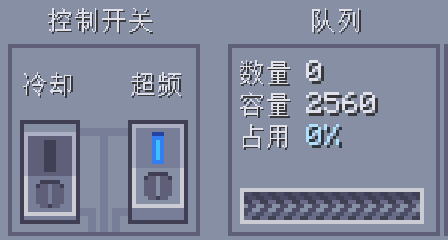
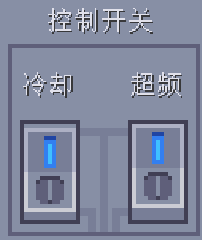
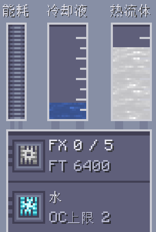
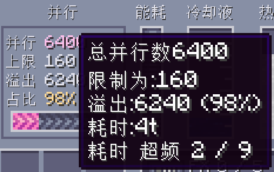
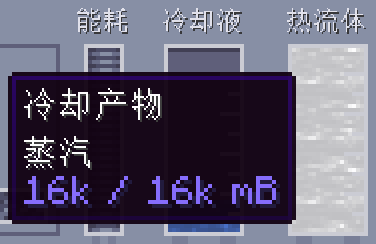

---
navigation:
  title: Crafting Controller Walkthrough
  icon: neoecoae:crafting_system_l9
  parent: neoecoae_intro/crafting_system.md
---

# Crafting Controller Walkthrough

This walkthrough uses actual in-game screenshots of a formed F9 host with five physical FX Workers. The screenshots use the Chinese UI; the numbered regions and explanations below identify each control. Counts, capacities, and processing times are examples; use your own controller's readings.

For structure assembly, see [ECO Crafting System](crafting_system.md) or [Multiblock Auto Builder](multiblock_builder.md).

## Find the controls

1. **Worker row**: one column per physical FX Worker, with upper and lower FT markers and task outputs when work is present.
2. **Mode switches**: active cooling on the left; overclocking on the right. A blue upper indicator means enabled.
3. **Queue**: accepted craft count, batch capacity, and utilization. Hover for full numbers.
4. **Parallel capacity**: FT capacity, base FX capacity, and overflow. Hover for processing time and effective overclock.
5. **Power and fluids**: energy use, converted coolant buffer, and fluid in the output hatch.
6. **Status summary**: active / total FX, FT capacity, coolant tier, exchange modules, and network multiplier.

`FX 0 / 5` means all five Workers are idle. A queue reading of 0% can be normal when no crafting task has been requested.

## Step 1: Make a pattern available

1. Form the multiblock and check that the controller shows its Worker columns.
2. Connect the <ItemLink id="neoecoae:crafting_interface" /> to a powered ME network.
3. Insert an encoded crafting pattern into a <ItemLink id="neoecoae:crafting_pattern_bus" />.
4. Request that craft from an ME terminal. The host executes patterns; a crafting CPU still schedules the job.

Once ordinary crafting works, increase batch capacity and speed using the steps below.

## Step 2: Enable the right switch

Click the **right-hand overclock switch**. Its upper indicator turns blue; the left cooling switch remains disabled in this screenshot.

The example host's batch capacity increases from **160** to **2560**: five FX Workers × 32 base crafts per Worker × the F9 overclock multiplier of 16. It still has five physical Workers. F4 and F6 use multipliers of 4 and 8 respectively.

Check that the network can supply the increased power demand. Active cooling can remove the extra energy cost of overclocking.

## Step 3: Enable cooling on the left

Click the **left-hand cooling switch** so that both switches have blue upper indicators. Supply coolant to the <ItemLink id="neoecoae:input_hatch" /> and leave room in the <ItemLink id="neoecoae:output_hatch" /> for cooling products.

The summary reads **water / OC limit 2**, meaning that water supports at most two overclock levels. The coolant gauge shows converted coolant buffer, not the remaining fluid in the input hatch. Open the input hatch to check its fluid supply.

Mekanism is installed in this example, so cooling with water produces steam in the output gauge. Check JEI for the products of other cooling recipes.

## Step 4: Read the effective speed

Hover over the **parallel capacity** region to read processing time and effective overclock.

The example shows **4 ticks and overclock 2 / 9**. The structure supports nine theoretical levels, while water limits the effective level to two. Ordinary finite crafting can work at the lower effective level.

Sodium supports up to six levels, and Cryotheum Solution supports up to nine. To change coolant, stop supplying the old fluid, empty the input hatch, and let ordinary crafting consume the old buffer before supplying the new fluid. New coolant cannot directly replace a different coolant already buffered.

## Step 5: Request a craft and watch the Workers

Request a craft from the ME terminal, then watch the Worker outputs and **active / total FX** summary. Queue count measures the number of crafts currently carried by the host. Hover to read complete numbers when the display abbreviates them. Fast tasks can return the queue and active FX count to zero almost immediately.

If no work arrives, check the pattern buses, ME connection, ingredients, available CPU, and power supply. See [ECO Computation System](computation_system.md) for CPU operation.

## Troubleshooting with the UI

### Output hatch full

The output gauge is full, and its tooltip reads **steam: 16k / 16k mB**. Cooling recipes with an output cannot replenish the buffer until there is space for that output. Extract the steam and check that replenishment resumes. Existing buffer can still be consumed; a full hatch does not immediately stop every task.

### Coolant missing or too weak

Check the input hatch's remaining fluid, the coolant name, and its **OC limit**. If effective overclock is below theoretical overclock, use the parallel tooltip to decide whether a higher-tier coolant is needed.

### Exchange or virtual crafting inactive

Check the exchange and multiplier summary, then hover over the blue **information button** at the upper right for status and missing conditions. See [F9 exchange and virtual crafting](crafting_system.md) for the full requirements.
